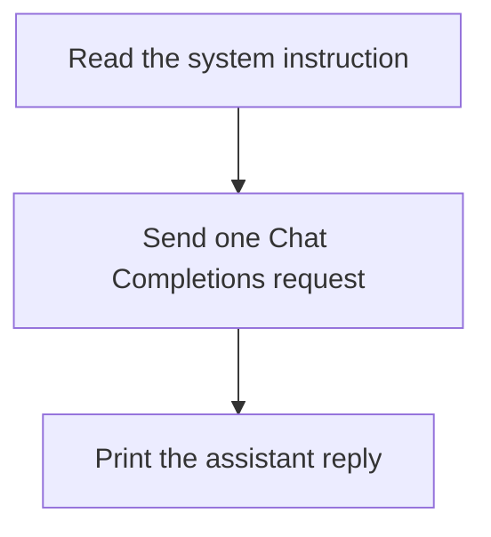

# Basic Chat

Send an independent Chat Completions request with a system instruction and your current question. Follow the stages in [Program.cs](Program.cs).

## Execution flow



## Run

From `AI-103/C#`, follow the [language setup](../../../README.md) for live Azure requests.

```sh
dotnet run --project "01-develop-generative-ai-apps/03-foundry-sdk/01-basic-chat"
```

One model request per nonempty prompt.

## Understand the results

A follow-up has no server-side reference to the earlier turn.

## Learn by changing an input

Ask about ELIZA, then ask how it compares to modern models. Compare the follow-up in Context Chat.

## Verify

Run the exercise with a compatible deployment and inspect the behavior described above.

## Files to read

- [Program.cs](Program.cs) shows the main execution flow.
- [Shared Foundry settings](../../../shared/FoundryOptions.cs) load the endpoint, model deployment, and credentials.
- See [OutputPrinter.cs](OutputPrinter.cs) for the lesson’s console presentation.

[Other language](../../../../python/01-develop-generative-ai-apps/03-foundry-sdk/01-basic-chat/README.md) · [Chapter study notes](../../../../study/01-develop-generative-ai-apps/03-foundry-sdk/README.md) · [AI-103 objectives](https://learn.microsoft.com/en-us/credentials/certifications/resources/study-guides/ai-103)
