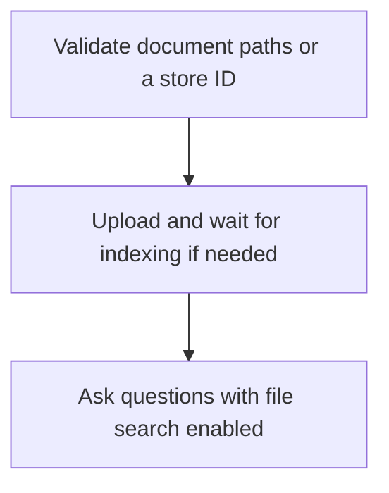

# File Search

Ground responses in documents indexed into a reusable vector store. Follow the stages in [Program.cs](Program.cs).

## Execution flow



## Run

From `AI-103/C#`, follow the [language setup](../../../README.md) for live Azure requests.

```sh
dotnet run --project "01-develop-generative-ai-apps/04-use-generative-ai-tools/09-file-search" -- ./path/to/documents
```

A new store makes upload and indexing requests. Each chat turn makes one Responses request. Reuse a `vs_...` ID to skip indexing.

## Understand the results

Sources are reported when the model returns file citations. A saved store ID lets you reuse the indexed documents.

## Learn by changing an input

Ask one question supported by a document and another about a fact missing from it.

## Verify

Run the exercise with a compatible deployment and inspect the behavior described above.

## Files to read

- [Program.cs](Program.cs) shows the main execution flow.
- [Shared Foundry settings](../../../shared/FoundryOptions.cs) load the endpoint, model deployment, and credentials.
- See [OutputPrinter.cs](OutputPrinter.cs) for the lesson’s console presentation.

[Other language](../../../../python/01-develop-generative-ai-apps/04-use-generative-ai-tools/09-file-search/README.md) · [Chapter study notes](../../../../study/01-develop-generative-ai-apps/04-use-generative-ai-tools/README.md) · [AI-103 objectives](https://learn.microsoft.com/en-us/credentials/certifications/resources/study-guides/ai-103)
