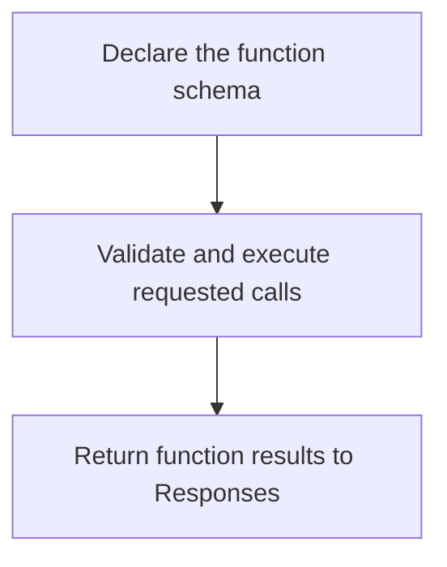

# Function Calling

Show how the model asks the application to run the allowlisted zero-argument `get_time` function. Follow the stages in [Program.cs](Program.cs).

## Execution flow



## Run

From `AI-103/C#`, follow the [language setup](../../../README.md) for live Azure requests.

```sh
dotnet run --project "01-develop-generative-ai-apps/04-use-generative-ai-tools/10-function-calling"
```

A prompt may make several model requests as function outputs are returned.

## Understand the results

The application supplies the host time. The round limit bounds consecutive function-call turns.

## Learn by changing an input

Ask for the local time. Compare the returned value with the clock on the machine running the lab.

## Verify

Run the exercise with a compatible deployment and inspect the behavior described above.

## Files to read

- [Program.cs](Program.cs) shows the main execution flow.
- [Shared Foundry settings](../../../shared/FoundryOptions.cs) load the endpoint, model deployment, and credentials.
- See [OutputPrinter.cs](OutputPrinter.cs) for the lesson’s console presentation.

[Other language](../../../../python/01-develop-generative-ai-apps/04-use-generative-ai-tools/10-function-calling/README.md) · [Chapter study notes](../../../../study/01-develop-generative-ai-apps/04-use-generative-ai-tools/README.md) · [AI-103 objectives](https://learn.microsoft.com/en-us/credentials/certifications/resources/study-guides/ai-103)
