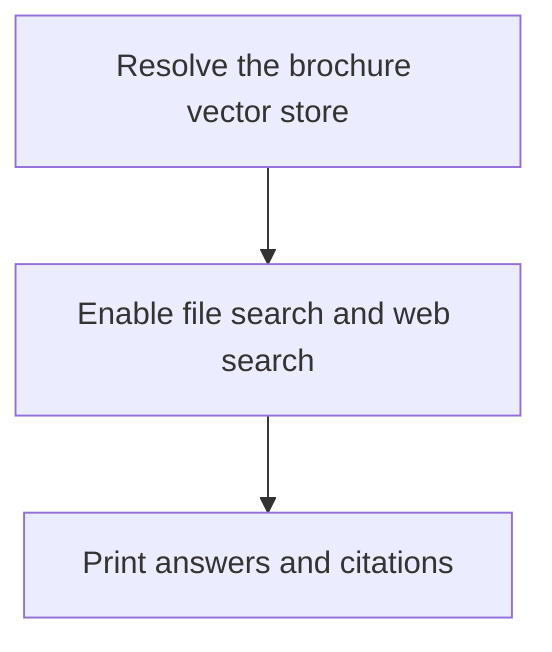

# Tools Chat

Use indexed travel brochures and current web information in the same conversation. Follow the stages in [Program.cs](Program.cs).

## Execution flow



## Run

From `AI-103/C#`, follow the [language setup](../../../README.md) for live Azure requests.

```sh
dotnet run --project "01-develop-generative-ai-apps/04-use-generative-ai-tools/11-tools-chat" -- ./path/to/brochures
```

A new store uploads and indexes PDFs before chat. Each chat turn makes one Responses request.

## Understand the results

Look for brochure citations on package questions and web citations on current destination questions.

## Learn by changing an input

Ask what is happening in San Francisco next month. Then ask which hotels Margie’s Travel offers there.

## Verify

Run the exercise with a compatible deployment and inspect the behavior described above.

## Files to read

- [Program.cs](Program.cs) shows the main execution flow.
- [Shared Foundry settings](../../../shared/FoundryOptions.cs) load the endpoint, model deployment, and credentials.
- See [OutputPrinter.cs](OutputPrinter.cs) for the lesson’s console presentation.

[Other language](../../../../python/01-develop-generative-ai-apps/04-use-generative-ai-tools/11-tools-chat/README.md) · [Chapter study notes](../../../../study/01-develop-generative-ai-apps/04-use-generative-ai-tools/README.md) · [AI-103 objectives](https://learn.microsoft.com/en-us/credentials/certifications/resources/study-guides/ai-103)
