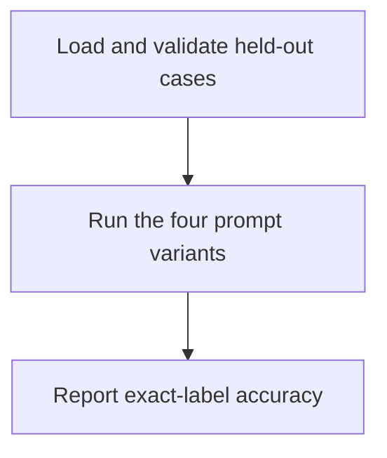

# Prompt Optimization

Compare four instruction and temperature variants on the same labeled travel-support examples. Follow the stages in [Program.cs](Program.cs).

## Execution flow



## Run

From `AI-103/C#`, follow the [language setup](../../../README.md) for live Azure requests.

```sh
dotnet run --project "01-develop-generative-ai-apps/05-optimize-generative-ai-model-performance/12-prompt-optimization" -- --preview
```

Preview is local. A default live run makes 64 model requests.

## Understand the results

Inspect correctness, latency, and failed requests by variant. The sample run has 16 cases per variant.

## Learn by changing an input

Preview the instructions, then change one example in the few-shot prompt and compare it against the same dataset.

## Verify

Run the preview above and check the case count before running the full lab.

## Files to read

- [Program.cs](Program.cs) shows the main execution flow.
- [Shared Foundry settings](../../../shared/FoundryOptions.cs) load the endpoint, model deployment, and credentials.
- See [OutputPrinter.cs](OutputPrinter.cs) for the lesson’s console presentation.

[Other language](../../../../python/01-develop-generative-ai-apps/05-optimize-generative-ai-model-performance/12-prompt-optimization/README.md) · [Chapter study notes](../../../../study/01-develop-generative-ai-apps/05-optimize-generative-ai-model-performance/README.md) · [AI-103 objectives](https://learn.microsoft.com/en-us/credentials/certifications/resources/study-guides/ai-103)

## Additional lab notes

**Microsoft Learn unit:** Optimize model output with prompt engineering.

Compare four prompt strategies on the *same* 16 labeled, held-out travel-support messages: a zero-shot request, detailed system instructions, few-shot examples, and few-shot examples with temperature zero. The lab records response quality, format compliance (exact label), latency, and reported token usage.

Run from `AI-103/C#`.

```bash
# No Azure credentials or API calls required:
dotnet run --project 01-develop-generative-ai-apps/05-optimize-generative-ai-model-performance/12-prompt-optimization -- --preview

# Uses C#/shared/.env or process environment variables:
dotnet run --project 01-develop-generative-ai-apps/05-optimize-generative-ai-model-performance/12-prompt-optimization -- --output prompt-results.csv
```

Optional arguments: `--dataset path/to/evaluation.json`, `--output path/to/results.csv`.

Inspect the CSV, compute accuracy as correct responses divided by completed requests, and compare latency and token counts. Failed requests are recorded separately. Some deployments do not accept the `temperature` parameter, so that variation may fail while the others complete; this is intentional evidence of model-parameter compatibility. Repeated runs are useful because output and latency can fluctuate.

**Expected environment:** `AZURE_OPENAI_ENDPOINT`, `MODEL_DEPLOYMENT`, and optionally `AZURE_OPENAI_API_KEY`, as in the existing shared client configuration. Inference calls may incur cost.
