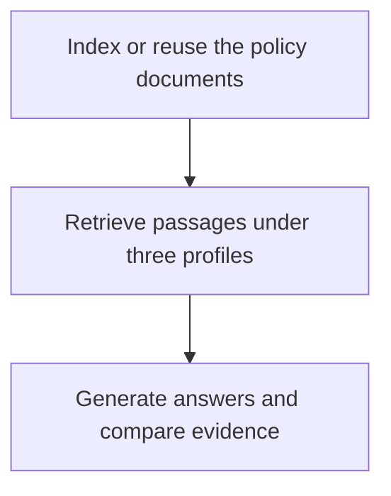

# RAG Retrieval Optimization

Compare vector-search ranking and retrieval settings with the rest of the answer prompt held fixed. Follow the stages in [Program.cs](Program.cs).

## Execution flow



## Run

From `AI-103/C#`, follow the [language setup](../../../README.md) for live Azure requests.

```sh
dotnet run --project "01-develop-generative-ai-apps/05-optimize-generative-ai-model-performance/13-rag-optimization" -- --sample
```

The sample issues 15 searches and up to 15 answer requests after creating or resolving the store.

## Understand the results

The sample report shows whether the expected file was retrieved and whether the answer contains the expected phrase.

## Learn by changing an input

Run the sample and change one profile’s result limit or score threshold. Compare the same five questions.

## Verify

Run the exercise with a compatible deployment and inspect the behavior described above.

## Files to read

- [Program.cs](Program.cs) shows the main execution flow.
- [Shared Foundry settings](../../../shared/FoundryOptions.cs) load the endpoint, model deployment, and credentials.
- See [OutputPrinter.cs](OutputPrinter.cs) for the lesson’s console presentation.

[Other language](../../../../python/01-develop-generative-ai-apps/05-optimize-generative-ai-model-performance/13-rag-optimization/README.md) · [Chapter study notes](../../../../study/01-develop-generative-ai-apps/05-optimize-generative-ai-model-performance/README.md) · [AI-103 objectives](https://learn.microsoft.com/en-us/credentials/certifications/resources/study-guides/ai-103)

## Additional lab notes

**Microsoft Learn unit:** Ground a model with Retrieval Augmented Generation.

Project 09 already demonstrates managed `file_search`. This project adds an explicit retrieve-then-generate pipeline using the `/vector_stores/{id}/search` endpoint so you can inspect and compare retrieval settings before generation.

Run from `AI-103/C#`.

```bash
# Creates a vector store from the three included fictional policy files,
# evaluates 5 fixed questions against three retrieval profiles, and writes CSV:
dotnet run --project 01-develop-generative-ai-apps/05-optimize-generative-ai-model-performance/13-rag-optimization -- --sample

# Reuse a previously created vector store for interactive questions:
dotnet run --project 01-develop-generative-ai-apps/05-optimize-generative-ai-model-performance/13-rag-optimization -- vs_...

# Or index your own documents and ask interactive questions:
dotnet run --project 01-develop-generative-ai-apps/05-optimize-generative-ai-model-performance/13-rag-optimization -- path/to/documents
```

The lab compares (1) fast retrieval without re-ranking, (2) re-ranked retrieval, and (3) query rewriting plus a score threshold. It prints retrieved filenames and similarity scores, then gives the model the returned passages directly. Questions are evaluated using simple expected phrases and file-name matches; these are **smoke-test metrics**, not human or model-graded factual correctness. Results are saved in `rag-optimization-results.csv`.

**Prerequisites:** same endpoint, deployment, and authentication as Projects 09 and 11. The deployment must support the Responses API. Supported files: `.pdf`, `.txt`, `.md`, `.docx`. Repeated `--sample` runs create new remote vector stores, which remain until you delete them. Retrieval and generation can incur usage charges. Treat retrieved text as untrusted and review it before using in a real application.
