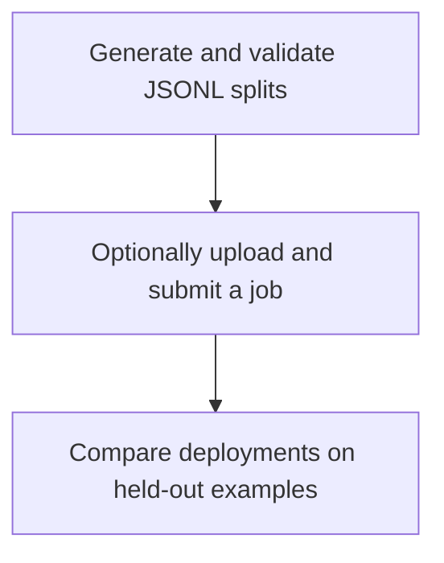

# Fine-Tuning

Practice the data and job lifecycle for a travel intent classifier. Follow the stages in [Program.cs](Program.cs).

## Execution flow



## Run

From `AI-103/C#`, follow the [language setup](../../../README.md) for live Azure requests.

```sh
dotnet run --project "01-develop-generative-ai-apps/05-optimize-generative-ai-model-performance/14-fine-tuning" -- prepare
```

Preparation and validation are local. Upload, job creation, status, and comparison use Azure. A job requires `--confirm-costs`.

## Understand the results

The offline path creates 40 training, 12 validation, and 12 held-out test examples. Live comparison reports exact-label accuracy.

## Learn by changing an input

Prepare and validate the files. Try a duplicate user example and observe which check rejects it.

## Verify

Run `validate` on the three generated files. Confirm the counts are 40, 12, and 12.

## Files to read

- [Program.cs](Program.cs) shows the main execution flow.
- [Shared Foundry settings](../../../shared/FoundryOptions.cs) load the endpoint, model deployment, and credentials.
- See [OutputPrinter.cs](OutputPrinter.cs) for the lesson’s console presentation.

[Other language](../../../../python/01-develop-generative-ai-apps/05-optimize-generative-ai-model-performance/14-fine-tuning/README.md) · [Chapter study notes](../../../../study/01-develop-generative-ai-apps/05-optimize-generative-ai-model-performance/README.md) · [AI-103 objectives](https://learn.microsoft.com/en-us/credentials/certifications/resources/study-guides/ai-103)

## Additional lab notes

**Microsoft Learn unit:** Fine-tune a model for consistent behavior.

This lab focuses on **behavioral consistency**, not adding factual knowledge. It generates balanced, fictional travel-support intent classification examples in the Azure/OpenAI chat fine-tuning JSONL format, validates records, optionally uploads them, submits a fine-tuning job with explicit confirmation, checks status, and compares a deployed result with a base deployment on held-out examples.

Run from `AI-103/C#`.

```bash
# Entirely offline and free:
dotnet run --project 01-develop-generative-ai-apps/05-optimize-generative-ai-model-performance/14-fine-tuning -- prepare
dotnet run --project 01-develop-generative-ai-apps/05-optimize-generative-ai-model-performance/14-fine-tuning -- validate fine-tuning-data/train.jsonl fine-tuning-data/validation.jsonl fine-tuning-data/test.jsonl

# Optional Azure operations. Save the returned file IDs:
dotnet run --project 01-develop-generative-ai-apps/05-optimize-generative-ai-model-performance/14-fine-tuning -- upload fine-tuning-data/train.jsonl
dotnet run --project 01-develop-generative-ai-apps/05-optimize-generative-ai-model-performance/14-fine-tuning -- upload fine-tuning-data/validation.jsonl

# REVIEW the selected base model's fine-tuning availability and charges FIRST.
# No job starts without this explicit option:
dotnet run --project 01-develop-generative-ai-apps/05-optimize-generative-ai-model-performance/14-fine-tuning -- create-job file-TRAIN_ID file-VALID_ID SUPPORTED_BASE_MODEL --confirm-costs

dotnet run --project 01-develop-generative-ai-apps/05-optimize-generative-ai-model-performance/14-fine-tuning -- status ftjob_YOUR_ID

# Deploy a successful fine-tuned model in Foundry, then compare both deployments:
dotnet run --project 01-develop-generative-ai-apps/05-optimize-generative-ai-model-performance/14-fine-tuning -- compare FINE_TUNED_DEPLOYMENT fine-tuning-data/test.jsonl
```

The `compare` command writes `fine-tuning-comparison.csv`, including exact-label correctness, request latency, and token counts. `prepare` generates 40 training / 12 validation / 12 held-out test examples and overwrites those files **only in the chosen output directory**. Do not put confidential conversations in training data without appropriate authorization.

**Prerequisites:** the same Azure endpoint and credentials used by the shared client. Fine-tuning support is dependent on model, region, quota, and account. The job consumes billable resources and may require separately deploying a successful model before inference. Uploads and jobs are left in the resource until you delete them.
