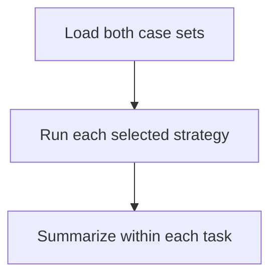

# Optimization Benchmark

Compare strategies separately on classification and policy fact questions. Follow the stages in [Program.cs](Program.cs).

## Execution flow



## Run

From `AI-103/C#`, follow the [language setup](../../../README.md) for live Azure requests.

```sh
dotnet run --project "01-develop-generative-ai-apps/05-optimize-generative-ai-model-performance/15-optimization-benchmark" -- --preview
```

Preview is local. The default live run makes 26 requests. Optional strategies add calls for their task.

## Understand the results

Intent uses exact-label matching. Policy facts use an expected-phrase check. API errors are recorded separately.

## Learn by changing an input

Preview the plan. Then run with `--limit 2` and compare each strategy on the same cases.

## Verify

Run the preview above and check the case count before running the full lab.

## Files to read

- [Program.cs](Program.cs) shows the main execution flow.
- [Shared Foundry settings](../../../shared/FoundryOptions.cs) load the endpoint, model deployment, and credentials.
- See [OutputPrinter.cs](OutputPrinter.cs) for the lesson’s console presentation.

[Other language](../../../../python/01-develop-generative-ai-apps/05-optimize-generative-ai-model-performance/15-optimization-benchmark/README.md) · [Chapter study notes](../../../../study/01-develop-generative-ai-apps/05-optimize-generative-ai-model-performance/README.md) · [AI-103 objectives](https://learn.microsoft.com/en-us/credentials/certifications/resources/study-guides/ai-103)

## Additional lab notes

**Microsoft Learn unit:** Compare and combine optimization strategies.

The benchmark uses two tracks, because fine-tuning a classifier and grounding factual answers solve different problems. **Do not pool their scores.**

1. **Travel intent classification:** same messages against the default deployment with a basic prompt, an improved few-shot prompt, and optionally a separately deployed fine-tuned model from Project 14. Metric: exact label match.
2. **Policy fact questions:** same questions against the default deployment with a basic prompt, instructions not to guess, and optionally `file_search` over the fictional policy documents indexed by Project 13. Metric: whether the expected phrase is present, a simple smoke test rather than a semantic or human evaluation.

Run from `AI-103/C#`.

```bash
# Offline: preview test counts and comparisons without sending requests
dotnet run --project 01-develop-generative-ai-apps/05-optimize-generative-ai-model-performance/15-optimization-benchmark -- --preview

# Baseline and prompt improvements, no optional deployments required:
dotnet run --project 01-develop-generative-ai-apps/05-optimize-generative-ai-model-performance/15-optimization-benchmark

# Include the vector store from 13.RagOptimization and a deployed fine-tuned model:
dotnet run --project 01-develop-generative-ai-apps/05-optimize-generative-ai-model-performance/15-optimization-benchmark -- --store vs_YOUR_ID --fine-tuned-deployment FINE_TUNED_DEPLOYMENT

# For a smaller/cheaper run, limit both tracks to the first N examples:
dotnet run --project 01-develop-generative-ai-apps/05-optimize-generative-ai-model-performance/15-optimization-benchmark -- --limit 2 --output quick-benchmark.csv
```

Results include strategy, task type, answer, match, response latency, and token usage in `optimization-benchmark.csv` by default. Interpret the two tracks **separately**, and review failed calls rather than treating them as incorrect answers. Scores should be rechecked with more representative data and human review before production use.

To enable RAG, create a vector store with `dotnet run --project 01-develop-generative-ai-apps/05-optimize-generative-ai-model-performance/13-rag-optimization -- --sample` and copy its returned `vs_...` ID. Use a deployed fine-tuned model name, **not** a training-job ID, for `--fine-tuned-deployment`. The baseline uses the `MODEL_DEPLOYMENT` from the shared client settings. Inference can incur charges.
