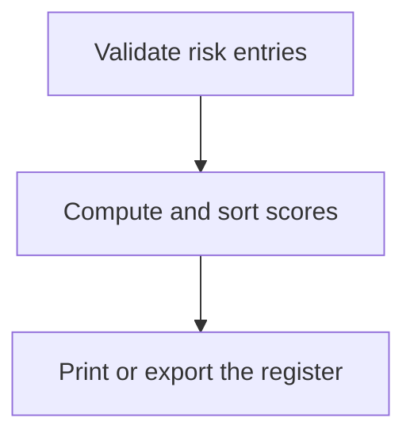

# Responsible AI Risk Assessment

Prioritize risks for a fictional travel assistant by combining likelihood and impact. Follow the stages in [Program.cs](Program.cs).

## Execution flow



## Run

From `AI-103/C#`, follow the [language setup](../../../README.md) for live Azure requests.

```sh
dotnet run --project "01-develop-generative-ai-apps/06-responsible-ai-studio/16-responsible-ai-risk-assessment" -- --preview
```

Runs locally. Add `--output risks.csv` in a regular run to save the register.

## Understand the results

Risk scores help compare cases. Owners, mitigations, and evidence provide the context needed to discuss priorities.

## Learn by changing an input

Add a plausible risk and adjust its likelihood. Explain its position in the ranked register.

## Verify

Run the preview above and check the case count before running the full lab.

## Files to read

- [Program.cs](Program.cs) shows the main execution flow.
- [Shared Foundry settings](../../../shared/FoundryOptions.cs) load the endpoint, model deployment, and credentials.
- See [OutputPrinter.cs](OutputPrinter.cs) for the lesson’s console presentation.

[Other language](../../../../python/01-develop-generative-ai-apps/06-responsible-ai-studio/16-responsible-ai-risk-assessment/README.md) · [Chapter study notes](../../../../study/01-develop-generative-ai-apps/06-responsible-ai-studio/README.md) · [AI-103 objectives](https://learn.microsoft.com/en-us/credentials/certifications/resources/study-guides/ai-103)

## Additional lab notes

**Microsoft Learn:** Implement a responsible generative AI solution in Microsoft Foundry. **Stage:** Map potential harms.

Use the fictional travel-support assistant from earlier labs to identify, prioritize, test, and document risks. The sample register includes eight proposed risks, ranging from factual errors to privacy, fairness, prompt injection, and rollback preparedness.

Run from `AI-103/C#`.

```bash
dotnet run --project 01-develop-generative-ai-apps/06-responsible-ai-studio/16-responsible-ai-risk-assessment -- --preview
dotnet run --project 01-develop-generative-ai-apps/06-responsible-ai-studio/16-responsible-ai-risk-assessment -- --output risks.csv
# Edit or replace the scenario data:
dotnet run --project 01-develop-generative-ai-apps/06-responsible-ai-studio/16-responsible-ai-risk-assessment -- --input 01-develop-generative-ai-apps/06-responsible-ai-studio/16-responsible-ai-risk-assessment/samples/risks.json
```

**Lab tasks:** (1) Identify an additional possible harm and provide its scenario, owner, and mitigation. (2) Assign likelihood and impact from 1 (low) to 5 (high). (3) Review the ordered risk register with a colleague acting as a stakeholder. (4) Add evidence from red-teaming and assign a status. (5) Export a CSV and explain why two risks with the same numeric score might still deserve different treatment.

The `HIGH`, `MEDIUM`, and `LOW` labels are **illustrative**, using score = likelihood x impact (15+ / 8+ / below 8). They do not replace impact assessments, compliance reviews, or expert judgment. The sample risks and scores are fictional, not findings about a live Azure deployment. **No Azure resource or credentials required.**

See [Microsoft Learn: Map potential harms](https://learn.microsoft.com/en-us/training/modules/responsible-ai-studio/3-identify-harms).
