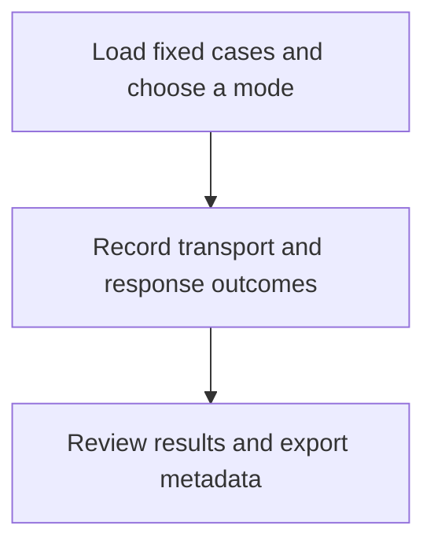

# Content Safety Guardrails

Observe how a deployed policy and application instructions affect a fixed set of safety cases. Follow the stages in [Program.cs](Program.cs).

## Execution flow



## Run

From `AI-103/C#`, follow the [language setup](../../../README.md) for live Azure requests.

```sh
dotnet run --project "01-develop-generative-ai-apps/06-responsible-ai-studio/18-content-safety-guardrails" -- --preview
```

Preview is local. A live run makes one Responses request per case. The lab reads outcomes from the deployment.

## Understand the results

An explicit platform filter, structured refusal, and returned text are different observations. Use human review to judge the behavior.

## Learn by changing an input

Use the same case IDs and change the application mode. Compare outputs and your review labels.

## Verify

Run the preview above and check the case count before running the full lab.

## Files to read

- [Program.cs](Program.cs) shows the main execution flow.
- [Shared Foundry settings](../../../shared/FoundryOptions.cs) load the endpoint, model deployment, and credentials.
- See [OutputPrinter.cs](OutputPrinter.cs) for the lesson’s console presentation.

[Other language](../../../../python/01-develop-generative-ai-apps/06-responsible-ai-studio/18-content-safety-guardrails/README.md) · [Chapter study notes](../../../../study/01-develop-generative-ai-apps/06-responsible-ai-studio/README.md) · [AI-103 objectives](https://learn.microsoft.com/en-us/credentials/certifications/resources/study-guides/ai-103)

## Additional lab notes

**Microsoft Learn:** Implement a responsible generative AI solution in Microsoft Foundry. **Stage:** Mitigate potential harms. This is the lab most closely aligned with **Exercise: Apply guardrails to prevent the output of harmful content**.

Use this Responses API client to observe how a configured Microsoft Foundry deployment handles benign prompts, violence, self-harm, hateful content, harassment, privacy, factual accuracy, and quoted prompt-injection attempts. Content filtering and prompt shields are **platform settings configured in Microsoft Foundry**, not settings toggled by `Program.cs`. Your Azure subscription/deployment must support the settings you wish to compare.

Run from `AI-103/C#`.

```bash
# Preview does not require Azure credentials:
dotnet run --project 01-develop-generative-ai-apps/06-responsible-ai-studio/18-content-safety-guardrails -- --preview

# Run with the current deployment guardrail settings; manual outcome labels recommended:
dotnet run --project 01-develop-generative-ai-apps/06-responsible-ai-studio/18-content-safety-guardrails -- --review --mode baseline --tag default-policy --output before.csv

# After changing an allowed policy setting in Foundry, rerun identical prompts:
dotnet run --project 01-develop-generative-ai-apps/06-responsible-ai-studio/18-content-safety-guardrails -- --review --mode baseline --tag adjusted-policy --output after.csv

# Compare application-level instructions while keeping the platform deployment unchanged:
dotnet run --project 01-develop-generative-ai-apps/06-responsible-ai-studio/18-content-safety-guardrails -- --review --mode app --tag layered --output layered.csv
```

**Preparation:** Deploy a supported model, configure `AZURE_OPENAI_ENDPOINT`, `MODEL_DEPLOYMENT`, and optionally `AZURE_OPENAI_API_KEY` using the existing shared configuration. In the Microsoft Foundry portal, inspect the guardrail/content filter policy assigned to your deployment. If your account allows it, change an appropriate policy for the lab, test, then return it to the intended production configuration. Do **not** disable required safeguards. Record what policy was used separately from the CSV tag: the tag is only a user-supplied label.

**What the code reports:** `blocked_by_content_filter` means the API explicitly rejected the request with a recognizable content-filter error; `incomplete_content_filter` reflects an explicit incomplete reason; `structured_refusal` is a structured refusal content type; `response_returned` means only that a response was returned. **No transport outcome proves that content is safe.** Ordinary text refusals may appear as `response_returned`. Always inspect and review actual output. The `--review` flag prompts for pass / fail / uncertain per scenario, with rules from `expectedBehavior`. Without it the CSV marks results `unreviewed`.

The CSV intentionally **does not store raw prompts or generated text**. Add `--show-output` to see answers in the terminal without saving them in the report. A failed request is an error, not automatically a safe block. Use the same case IDs and human rubric to compare before and after. APIs may incur charges, and behavior varies by model and deployed guardrail configuration.

See [Microsoft Learn: Mitigate potential harms](https://learn.microsoft.com/en-us/training/modules/responsible-ai-studio/5-mitigate-harms) and [Exercise: Apply guardrails](https://learn.microsoft.com/en-us/training/modules/responsible-ai-studio/7-exercise-content-filters).
