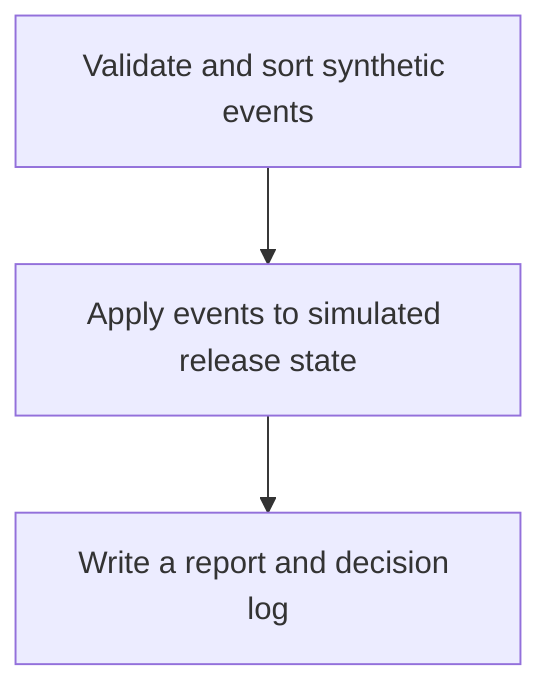

# Responsible AI Operations

Simulate rollout, repeated abuse reports, incident escalation, and rollback using synthetic events. Follow the stages in [Program.cs](Program.cs).

## Execution flow



## Run

From `AI-103/C#`, follow the [language setup](../../../README.md) for live Azure requests.

```sh
dotnet run --project "01-develop-generative-ai-apps/06-responsible-ai-studio/19-responsible-ai-operations" -- --preview
```

Runs locally. Run with `--output ops-report.json` to write the simulated state.

## Understand the results

The decision trail explains why the rollout is paused, approved, or held and which actors are marked for simulated blocking.

## Learn by changing an input

Change the severity of one verified event. Compare the final configuration and decision log.

## Verify

Run the preview above and check the case count before running the full lab.

## Files to read

- [Program.cs](Program.cs) shows the main execution flow.
- [Shared Foundry settings](../../../shared/FoundryOptions.cs) load the endpoint, model deployment, and credentials.
- See [OutputPrinter.cs](OutputPrinter.cs) for the lesson’s console presentation.

[Other language](../../../../python/01-develop-generative-ai-apps/06-responsible-ai-studio/19-responsible-ai-operations/README.md) · [Chapter study notes](../../../../study/01-develop-generative-ai-apps/06-responsible-ai-studio/README.md) · [AI-103 objectives](https://learn.microsoft.com/en-us/credentials/certifications/resources/study-guides/ai-103)

## Additional lab notes

**Microsoft Learn:** Implement a responsible generative AI solution in Microsoft Foundry. **Stage:** Manage a responsible generative AI solution.

A **fully offline simulation** of phased rollout, user feedback, abuse detection, incident escalation, response blocking, and rollback. The events are fictional and the actor tokens are synthetic and pseudonymous. The program generates a JSON decision trail and final release state. **It does not call Azure, change a deployment, block a real user, or implement a production kill switch.**

Run from `AI-103/C#`.

```bash
dotnet run --project 01-develop-generative-ai-apps/06-responsible-ai-studio/19-responsible-ai-operations -- --preview
dotnet run --project 01-develop-generative-ai-apps/06-responsible-ai-studio/19-responsible-ai-operations -- --output ops-report.json
# Change the synthetic events to explore other incident outcomes:
dotnet run --project 01-develop-generative-ai-apps/06-responsible-ai-studio/19-responsible-ai-operations -- --events 01-develop-generative-ai-apps/06-responsible-ai-studio/19-responsible-ai-operations/samples/events.json
```

**Tasks:** (1) Identify which changes require human approval; (2) inspect how a verified, high-severity incident pauses rollout and restores a previous configuration in the simulation; (3) demonstrate the difference between unverified abuse reports and repeated verified abuse; (4) add new events and verify how decisions change; (5) review the operational checklist in `INCIDENT_PLAYBOOK.md`.

The resulting report intentionally omits prompts, generated responses, raw IP addresses, customer identities, and secrets. In a real system, add authentication, authorization, retention controls, telemetry, escalation rules, evidence management, user appeals, and tested automation before deploying any incident-response mechanism. The simulator does not assert that all risks are mitigated.

See [Microsoft Learn: Manage a responsible generative AI solution](https://learn.microsoft.com/en-us/training/modules/responsible-ai-studio/6-operate-responsibly).
