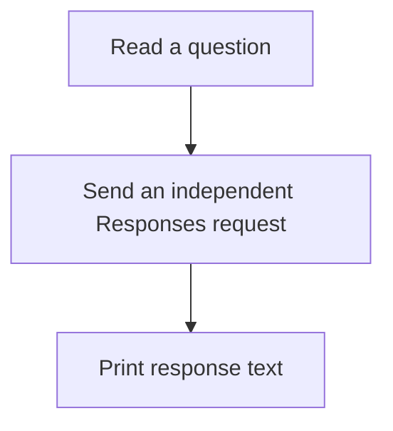

# Responses Chat

Send a standalone question through the Responses API. Follow the stages in [main.py](main.py).

## Execution flow



## Run

From `AI-103/python`, follow the [language setup](../../../README.md) for live Azure requests.

```sh
python -m 01-develop-generative-ai-apps.03-foundry-sdk.02-responses-chat.main
```

One model request per nonempty prompt.

## Understand the results

Each prompt is evaluated by itself.

## Learn by changing an input

Ask two related questions and inspect the second answer without conversation context.

## Verify

Run the exercise with a compatible deployment and inspect the behavior described above.

## Files to read

- [main.py](main.py) shows the main execution flow.
- [Shared Foundry settings](../../../shared/foundry.py) load the endpoint, model deployment, and credentials.

[Other language](../../../../C%23/01-develop-generative-ai-apps/03-foundry-sdk/02-responses-chat/README.md) · [Chapter study notes](../../../../study/01-develop-generative-ai-apps/03-foundry-sdk/README.md) · [AI-103 objectives](https://learn.microsoft.com/en-us/credentials/certifications/resources/study-guides/ai-103)
