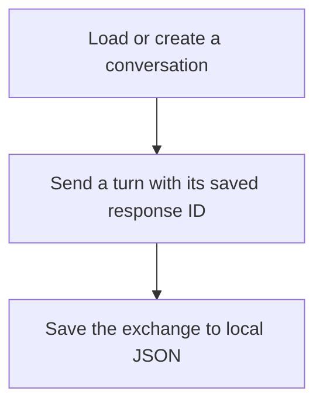

# Chat History

Save conversations locally and resume a Responses API conversation by its stored response ID. Follow the stages in [main.py](main.py).

## Execution flow



## Run

From `AI-103/python`, follow the [language setup](../../../README.md) for live Azure requests.

```sh
python -m 01-develop-generative-ai-apps.03-foundry-sdk.06-chat-history.main
```

History commands are local. A chat turn makes one model request.

## Understand the results

The JSON stores plaintext messages and the last response ID. Local history can still be read if a server-side response expires.

## Learn by changing an input

Use `new Demo`, send a message, quit, restart, and use `list`, `use <id>`, and `show`.

## Verify

Run the exercise with a compatible deployment and inspect the behavior described above.

## Files to read

- [main.py](main.py) shows the main execution flow.
- [Shared Foundry settings](../../../shared/foundry.py) load the endpoint, model deployment, and credentials.
- See [conversations.py](conversations.py) for the local JSON store.

[Other language](../../../../C%23/01-develop-generative-ai-apps/03-foundry-sdk/06-chat-history/README.md) · [Chapter study notes](../../../../study/01-develop-generative-ai-apps/03-foundry-sdk/README.md) · [AI-103 objectives](https://learn.microsoft.com/en-us/credentials/certifications/resources/study-guides/ai-103)
