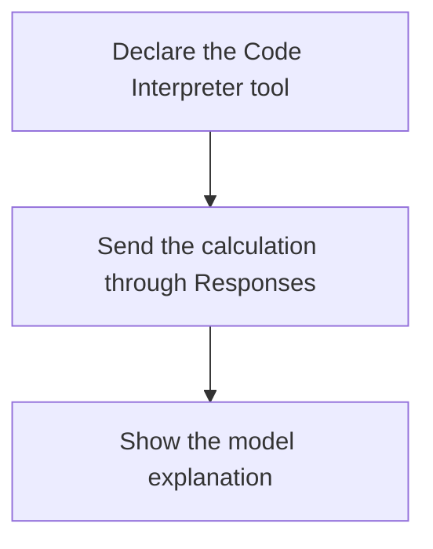

# Code Interpreter

Give the model access to hosted Python for a calculation or data analysis. Follow the stages in [main.py](main.py).

## Execution flow



## Run

From `AI-103/python`, follow the [language setup](../../../README.md) for live Azure requests.

```sh
python -m 01-develop-generative-ai-apps.04-use-generative-ai-tools.07-code-interpreter.main
```

One Responses request per prompt. Hosted tool use can incur additional charges.

## Understand the results

The model can use a hosted Python container and explain the result.

## Learn by changing an input

Ask for the square root of 16, then ask for an intermediate calculation and check it by hand.

## Verify

Run the exercise with a compatible deployment and inspect the behavior described above.

## Files to read

- [main.py](main.py) shows the main execution flow.
- [Shared Foundry settings](../../../shared/foundry.py) load the endpoint, model deployment, and credentials.

[Other language](../../../../C%23/01-develop-generative-ai-apps/04-use-generative-ai-tools/07-code-interpreter/README.md) · [Chapter study notes](../../../../study/01-develop-generative-ai-apps/04-use-generative-ai-tools/README.md) · [AI-103 objectives](https://learn.microsoft.com/en-us/credentials/certifications/resources/study-guides/ai-103)
