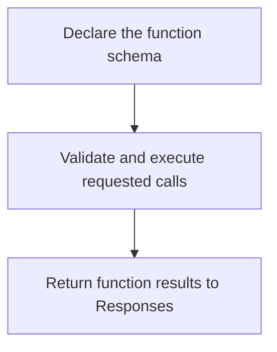

# Function Calling

Show how the model asks the application to run the allowlisted zero-argument `get_time` function. Follow the stages in [main.py](main.py).

## Execution flow



## Run

From `AI-103/python`, follow the [language setup](../../../README.md) for live Azure requests.

```sh
python -m 01-develop-generative-ai-apps.04-use-generative-ai-tools.10-function-calling.main
```

A prompt may make several model requests as function outputs are returned.

## Understand the results

The application supplies the host time. The round limit bounds consecutive function-call turns.

## Learn by changing an input

Ask for the local time. Compare the returned value with the clock on the machine running the lab.

## Verify

Run the exercise with a compatible deployment and inspect the behavior described above.

## Files to read

- [main.py](main.py) shows the main execution flow.
- [Shared Foundry settings](../../../shared/foundry.py) load the endpoint, model deployment, and credentials.

[Other language](../../../../C%23/01-develop-generative-ai-apps/04-use-generative-ai-tools/10-function-calling/README.md) · [Chapter study notes](../../../../study/01-develop-generative-ai-apps/04-use-generative-ai-tools/README.md) · [AI-103 objectives](https://learn.microsoft.com/en-us/credentials/certifications/resources/study-guides/ai-103)
