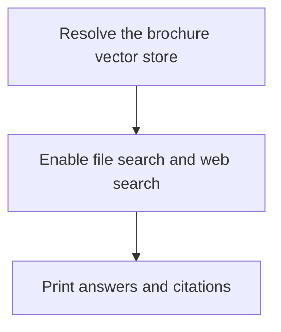

# Tools Chat

Use indexed travel brochures and current web information in the same conversation. Follow the stages in [main.py](main.py).

## Execution flow



## Run

From `AI-103/python`, follow the [language setup](../../../README.md) for live Azure requests.

```sh
python -m 01-develop-generative-ai-apps.04-use-generative-ai-tools.11-tools-chat.main ./path/to/brochures
```

A new store uploads and indexes PDFs before chat. Each chat turn makes one Responses request.

## Understand the results

Look for brochure citations on package questions and web citations on current destination questions.

## Learn by changing an input

Ask what is happening in San Francisco next month. Then ask which hotels Margie’s Travel offers there.

## Verify

Run the exercise with a compatible deployment and inspect the behavior described above.

## Files to read

- [main.py](main.py) shows the main execution flow.
- [Shared Foundry settings](../../../shared/foundry.py) load the endpoint, model deployment, and credentials.

[Other language](../../../../C%23/01-develop-generative-ai-apps/04-use-generative-ai-tools/11-tools-chat/README.md) · [Chapter study notes](../../../../study/01-develop-generative-ai-apps/04-use-generative-ai-tools/README.md) · [AI-103 objectives](https://learn.microsoft.com/en-us/credentials/certifications/resources/study-guides/ai-103)

Use the [brochure instructions](BROCHURES.md) to obtain the exercise PDFs.
