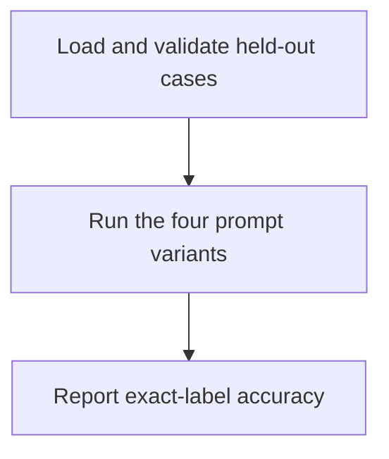

# Prompt Optimization

Compare four instruction and temperature variants on the same labeled travel-support examples. Follow the stages in [main.py](main.py).

## Execution flow



## Run

From `AI-103/python`, follow the [language setup](../../../README.md) for live Azure requests.

```sh
python -m 01-develop-generative-ai-apps.05-optimize-generative-ai-model-performance.12-prompt-optimization.main --preview
```

Preview is local. A default live run makes 64 model requests.

## Understand the results

Inspect correctness, latency, and failed requests by variant. The sample run has 16 cases per variant.

## Learn by changing an input

Preview the instructions, then change one example in the few-shot prompt and compare it against the same dataset.

## Verify

Run the preview above and check the case count before running the full lab.

## Files to read

- [main.py](main.py) shows the main execution flow.
- [Shared Foundry settings](../../../shared/foundry.py) load the endpoint, model deployment, and credentials.

[Other language](../../../../C%23/01-develop-generative-ai-apps/05-optimize-generative-ai-model-performance/12-prompt-optimization/README.md) · [Chapter study notes](../../../../study/01-develop-generative-ai-apps/05-optimize-generative-ai-model-performance/README.md) · [AI-103 objectives](https://learn.microsoft.com/en-us/credentials/certifications/resources/study-guides/ai-103)
