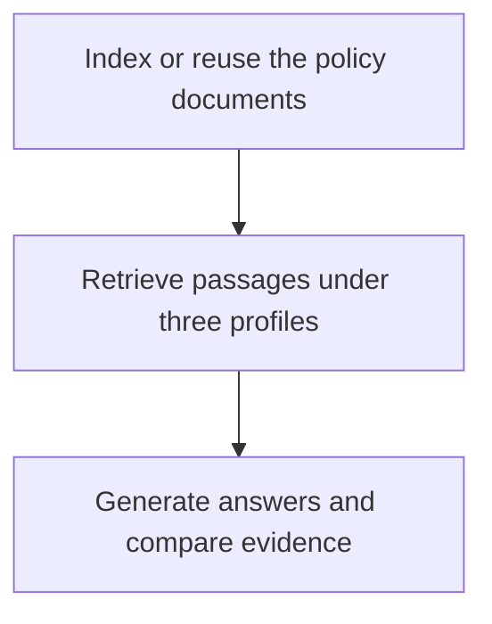

# RAG Retrieval Optimization

Compare vector-search ranking and retrieval settings with the rest of the answer prompt held fixed. Follow the stages in [main.py](main.py).

## Execution flow



## Run

From `AI-103/python`, follow the [language setup](../../../README.md) for live Azure requests.

```sh
python -m 01-develop-generative-ai-apps.05-optimize-generative-ai-model-performance.13-rag-optimization.main --sample
```

The sample issues 15 searches and up to 15 answer requests after creating or resolving the store.

## Understand the results

The sample report shows whether the expected file was retrieved and whether the answer contains the expected phrase.

## Learn by changing an input

Run the sample and change one profile’s result limit or score threshold. Compare the same five questions.

## Verify

Run the exercise with a compatible deployment and inspect the behavior described above.

## Files to read

- [main.py](main.py) shows the main execution flow.
- [Shared Foundry settings](../../../shared/foundry.py) load the endpoint, model deployment, and credentials.

[Other language](../../../../C%23/01-develop-generative-ai-apps/05-optimize-generative-ai-model-performance/13-rag-optimization/README.md) · [Chapter study notes](../../../../study/01-develop-generative-ai-apps/05-optimize-generative-ai-model-performance/README.md) · [AI-103 objectives](https://learn.microsoft.com/en-us/credentials/certifications/resources/study-guides/ai-103)
