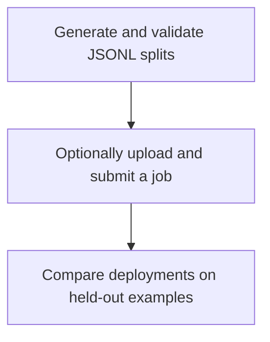

# Fine-Tuning

Practice the data and job lifecycle for a travel intent classifier. Follow the stages in [main.py](main.py).

## Execution flow



## Run

From `AI-103/python`, follow the [language setup](../../../README.md) for live Azure requests.

```sh
python -m 01-develop-generative-ai-apps.05-optimize-generative-ai-model-performance.14-fine-tuning.main prepare
```

Preparation and validation are local. Upload, job creation, status, and comparison use Azure. A job requires `--confirm-costs`.

## Understand the results

The offline path creates 40 training, 12 validation, and 12 held-out test examples. Live comparison reports exact-label accuracy.

## Learn by changing an input

Prepare and validate the files. Try a duplicate user example and observe which check rejects it.

## Verify

Run `validate` on the three generated files. Confirm the counts are 40, 12, and 12.

## Files to read

- [main.py](main.py) shows the main execution flow.
- [Shared Foundry settings](../../../shared/foundry.py) load the endpoint, model deployment, and credentials.
- See [training_data.py](training_data.py) for JSONL generation and validation.

[Other language](../../../../C%23/01-develop-generative-ai-apps/05-optimize-generative-ai-model-performance/14-fine-tuning/README.md) · [Chapter study notes](../../../../study/01-develop-generative-ai-apps/05-optimize-generative-ai-model-performance/README.md) · [AI-103 objectives](https://learn.microsoft.com/en-us/credentials/certifications/resources/study-guides/ai-103)

## Fine-tuning commands

```sh
python -m 01-develop-generative-ai-apps.05-optimize-generative-ai-model-performance.14-fine-tuning.main validate fine-tuning-data/train.jsonl fine-tuning-data/validation.jsonl fine-tuning-data/test.jsonl
python -m 01-develop-generative-ai-apps.05-optimize-generative-ai-model-performance.14-fine-tuning.main upload fine-tuning-data/train.jsonl
python -m 01-develop-generative-ai-apps.05-optimize-generative-ai-model-performance.14-fine-tuning.main upload fine-tuning-data/validation.jsonl
python -m 01-develop-generative-ai-apps.05-optimize-generative-ai-model-performance.14-fine-tuning.main create-job file-TRAIN_ID file-VALIDATION_ID SUPPORTED_BASE_MODEL --confirm-costs
python -m 01-develop-generative-ai-apps.05-optimize-generative-ai-model-performance.14-fine-tuning.main status ftjob_ID
python -m 01-develop-generative-ai-apps.05-optimize-generative-ai-model-performance.14-fine-tuning.main compare FINE_TUNED_DEPLOYMENT fine-tuning-data/test.jsonl
```

Use uploaded file IDs for job creation and the deployed model name for comparison.
