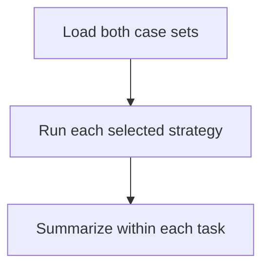

# Optimization Benchmark

Compare strategies separately on classification and policy fact questions. Follow the stages in [main.py](main.py).

## Execution flow



## Run

From `AI-103/python`, follow the [language setup](../../../README.md) for live Azure requests.

```sh
python -m 01-develop-generative-ai-apps.05-optimize-generative-ai-model-performance.15-optimization-benchmark.main --preview
```

Preview is local. The default live run makes 26 requests. Optional strategies add calls for their task.

## Understand the results

Intent uses exact-label matching. Policy facts use an expected-phrase check. API errors are recorded separately.

## Learn by changing an input

Preview the plan. Then run with `--limit 2` and compare each strategy on the same cases.

## Verify

Run the preview above and check the case count before running the full lab.

## Files to read

- [main.py](main.py) shows the main execution flow.
- [Shared Foundry settings](../../../shared/foundry.py) load the endpoint, model deployment, and credentials.

[Other language](../../../../C%23/01-develop-generative-ai-apps/05-optimize-generative-ai-model-performance/15-optimization-benchmark/README.md) · [Chapter study notes](../../../../study/01-develop-generative-ai-apps/05-optimize-generative-ai-model-performance/README.md) · [AI-103 objectives](https://learn.microsoft.com/en-us/credentials/certifications/resources/study-guides/ai-103)
