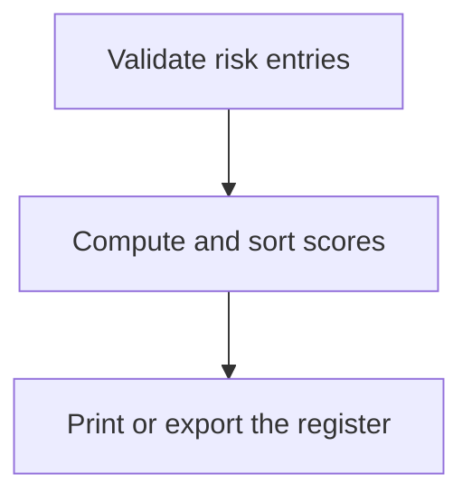

# Responsible AI Risk Assessment

Prioritize risks for a fictional travel assistant by combining likelihood and impact. Follow the stages in [main.py](main.py).

## Execution flow



## Run

From `AI-103/python`, follow the [language setup](../../../README.md) for live Azure requests.

```sh
python -m 01-develop-generative-ai-apps.06-responsible-ai-studio.16-responsible-ai-risk-assessment.main --preview
```

Runs locally. Add `--output risks.csv` in a regular run to save the register.

## Understand the results

Risk scores help compare cases. Owners, mitigations, and evidence provide the context needed to discuss priorities.

## Learn by changing an input

Add a plausible risk and adjust its likelihood. Explain its position in the ranked register.

## Verify

Run the preview above and check the case count before running the full lab.

## Files to read

- [main.py](main.py) shows the main execution flow.
- [Shared Foundry settings](../../../shared/foundry.py) load the endpoint, model deployment, and credentials.

[Other language](../../../../C%23/01-develop-generative-ai-apps/06-responsible-ai-studio/16-responsible-ai-risk-assessment/README.md) · [Chapter study notes](../../../../study/01-develop-generative-ai-apps/06-responsible-ai-studio/README.md) · [AI-103 objectives](https://learn.microsoft.com/en-us/credentials/certifications/resources/study-guides/ai-103)
