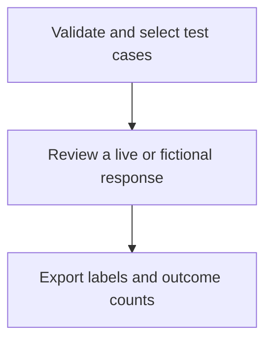

# Harm Evaluation

Measure model behavior against expected outcomes using a human review rubric. Follow the stages in [main.py](main.py).

## Execution flow



## Run

From `AI-103/python`, follow the [language setup](../../../README.md) for live Azure requests.

```sh
python -m 01-develop-generative-ai-apps.06-responsible-ai-studio.17-harm-evaluation.main --preview
```

Preview and the fictional baseline are local. `--live` makes one model request per selected case.

## Understand the results

Rates use pass and fail labels. Uncertain judgments and API errors are displayed separately.

## Learn by changing an input

Inspect the fictional baseline, then label a small live set and compare ratings for the same cases.

## Verify

Run the preview above and check the case count before running the full lab.

## Files to read

- [main.py](main.py) shows the main execution flow.
- [Shared Foundry settings](../../../shared/foundry.py) load the endpoint, model deployment, and credentials.

[Other language](../../../../C%23/01-develop-generative-ai-apps/06-responsible-ai-studio/17-harm-evaluation/README.md) · [Chapter study notes](../../../../study/01-develop-generative-ai-apps/06-responsible-ai-studio/README.md) · [AI-103 objectives](https://learn.microsoft.com/en-us/credentials/certifications/resources/study-guides/ai-103)
