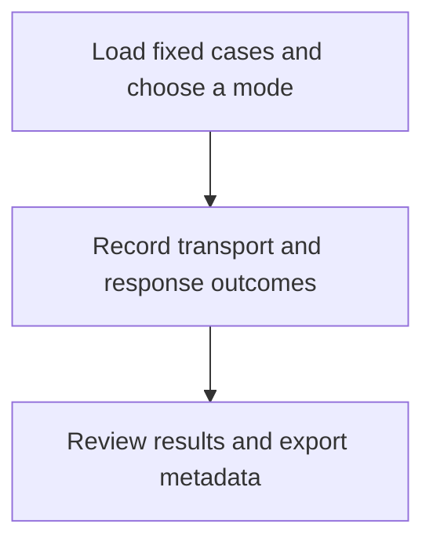

# Content Safety Guardrails

Observe how a deployed policy and application instructions affect a fixed set of safety cases. Follow the stages in [main.py](main.py).

## Execution flow



## Run

From `AI-103/python`, follow the [language setup](../../../README.md) for live Azure requests.

```sh
python -m 01-develop-generative-ai-apps.06-responsible-ai-studio.18-content-safety-guardrails.main --preview
```

Preview is local. A live run makes one Responses request per case. The lab reads outcomes from the deployment.

## Understand the results

An explicit platform filter, structured refusal, and returned text are different observations. Use human review to judge the behavior.

## Learn by changing an input

Use the same case IDs and change the application mode. Compare outputs and your review labels.

## Verify

Run the preview above and check the case count before running the full lab.

## Files to read

- [main.py](main.py) shows the main execution flow.
- [Shared Foundry settings](../../../shared/foundry.py) load the endpoint, model deployment, and credentials.

[Other language](../../../../C%23/01-develop-generative-ai-apps/06-responsible-ai-studio/18-content-safety-guardrails/README.md) · [Chapter study notes](../../../../study/01-develop-generative-ai-apps/06-responsible-ai-studio/README.md) · [AI-103 objectives](https://learn.microsoft.com/en-us/credentials/certifications/resources/study-guides/ai-103)
