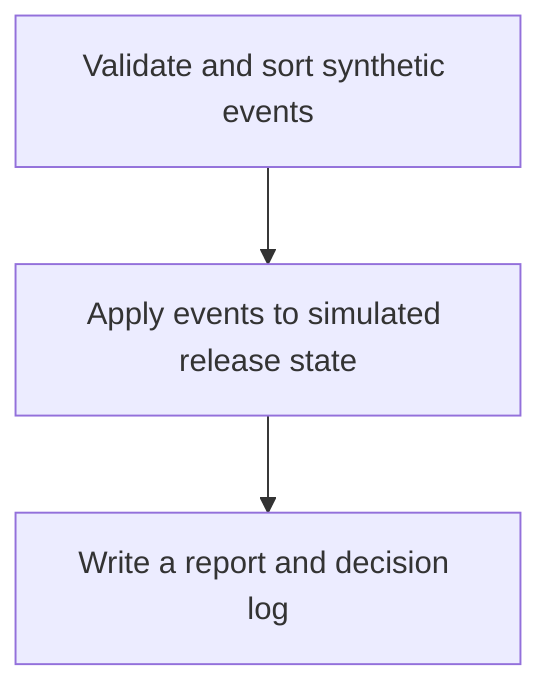

# Responsible AI Operations

Simulate rollout, repeated abuse reports, incident escalation, and rollback using synthetic events. Follow the stages in [main.py](main.py).

## Execution flow



## Run

From `AI-103/python`, follow the [language setup](../../../README.md) for live Azure requests.

```sh
python -m 01-develop-generative-ai-apps.06-responsible-ai-studio.19-responsible-ai-operations.main --preview
```

Runs locally. Run with `--output ops-report.json` to write the simulated state.

## Understand the results

The decision trail explains why the rollout is paused, approved, or held and which actors are marked for simulated blocking.

## Learn by changing an input

Change the severity of one verified event. Compare the final configuration and decision log.

## Verify

Run the preview above and check the case count before running the full lab.

## Files to read

- [main.py](main.py) shows the main execution flow.
- [Shared Foundry settings](../../../shared/foundry.py) load the endpoint, model deployment, and credentials.

[Other language](../../../../C%23/01-develop-generative-ai-apps/06-responsible-ai-studio/19-responsible-ai-operations/README.md) · [Chapter study notes](../../../../study/01-develop-generative-ai-apps/06-responsible-ai-studio/README.md) · [AI-103 objectives](https://learn.microsoft.com/en-us/credentials/certifications/resources/study-guides/ai-103)

Read the [incident playbook](INCIDENT_PLAYBOOK.md) to compare the simulation with operational decisions.
